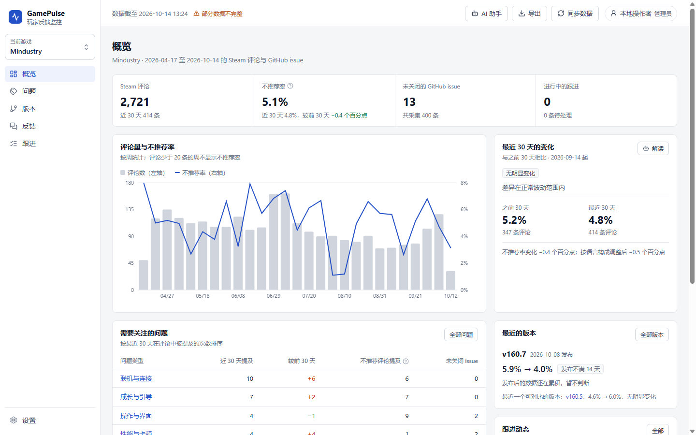
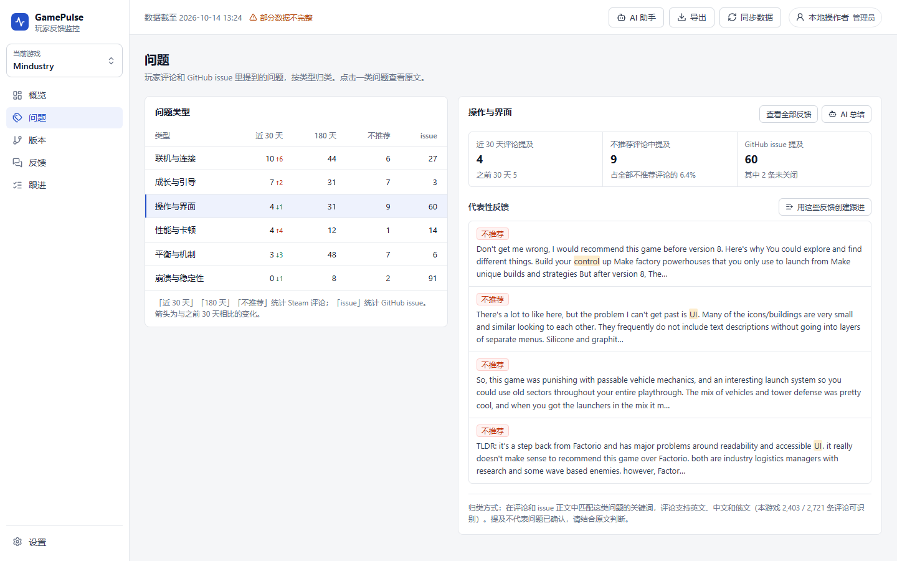
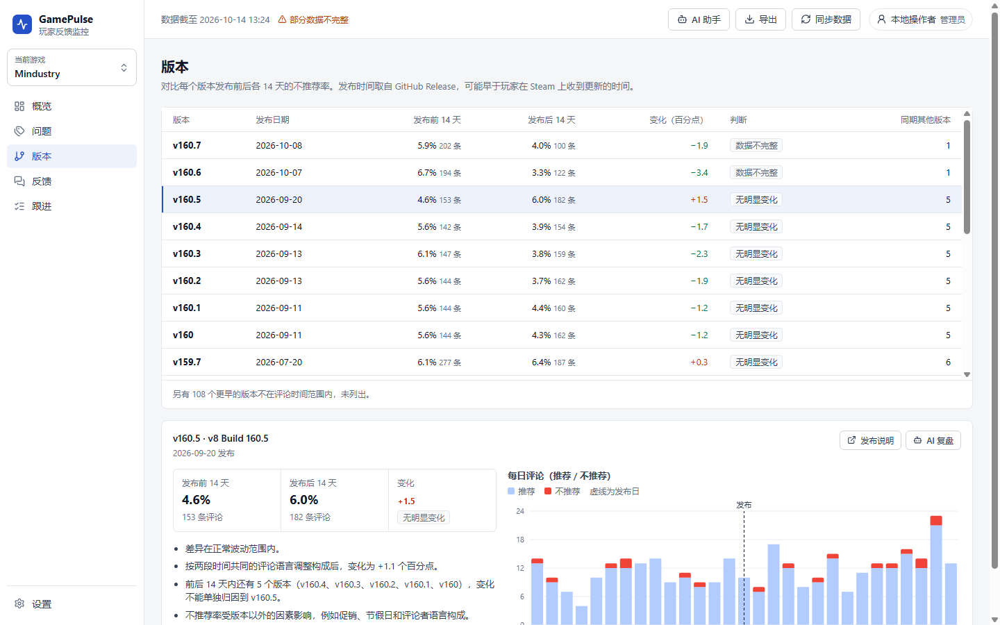
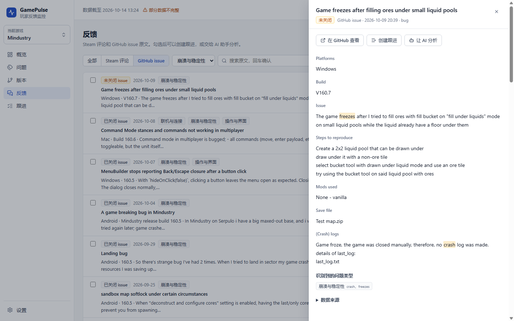
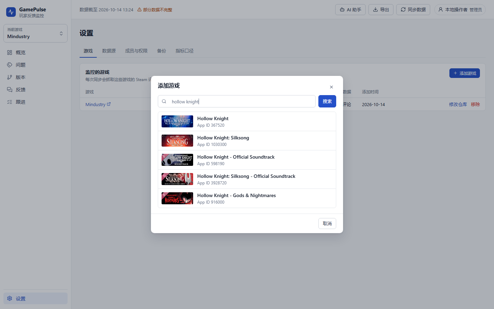

# GamePulse · 玩家反馈监控

GamePulse 把游戏在 Steam 上的玩家评论和在 GitHub 上的公开 issue 汇总到一起，帮产品、QA 和社区团队回答三个问题：

1. **玩家最近在抱怨什么？** 把评论和 issue 归入崩溃、性能、联机、操作、成长、平衡六类问题，看哪类在上升，并直接读原文。
2. **这次更新后口碑变好了还是变差了？** 对比每个版本发布前后各 14 天的不推荐率，并说明变化是否超出正常波动。
3. **这些问题有没有人在处理？** 从反馈中创建跟进，指定负责人，记录每一次状态变化和处理说明。



## 功能

| 页面 | 用途 |
|---|---|
| 概览 | 评论量、不推荐率、最近 30 天的变化、需要关注的问题、最近的版本，以及按游玩时长和语言的分布 |
| 问题 | 六类问题在近 30 天和 180 天内的提及量、在不推荐评论中的占比、对应的 GitHub issue，附代表性原文 |
| 版本 | 每个版本发布前后 14 天的对比、判断结论、同期其他版本提示和每日评论图 |
| 反馈 | 按来源、问题类型、推荐状态、语言和关键词检索原文；勾选后创建跟进或交给 AI 助手 |
| 跟进 | 待处理 / 调查中 / 已确认 / 已关闭，每条跟进保留关联反馈和完整处理记录 |
| 设置 | 要监控的游戏、数据源与同步记录、成员与权限、备份、指标口径 |

左侧边栏顶部切换当前游戏，所有页面都跟着切换。右上角的 **AI 助手** 调用本机已登录的 Codex CLI，只读当前数据快照；回答里的数字和引用由程序逐条核对，核对不过的回答会被标记出来。

| 问题 | 版本 | 反馈详情 | 添加游戏 |
|---|---|---|---|
|  |  |  |  |

## 要监控哪些游戏

系统不预置任何游戏和数据。在侧边栏或「设置 → 游戏」里点「添加游戏」，按名称或 App ID 在 Steam 上查找；如果开发团队有公开的 GitHub 仓库，可以一起关联。添加后点「同步数据」即可。

| 来源 | 内容 | 条件 |
|---|---|---|
| Steam 评论 | 时间范围内的全部语言评论，官方 `IUserReviewsService/GetAppReviews` 接口 | 每款游戏都会抓取 |
| GitHub issue | 时间范围内有更新的公开 issue，不含 PR | 关联了仓库才抓取 |
| GitHub Release | 版本号和发布时间，用于版本前后对比 | 关联了仓库才抓取 |

每次同步先把原始响应按 SHA-256 存档，校验字段后再计算指标；每条反馈都能追溯到它所在的原始响应页，同一份原始数据离线重新计算，结果指纹不变。每款游戏可以单独同步，各自显示最近一次同步的结果。接口和覆盖规则见 [数据来源](docs/DATA_SOURCES.md)。

## 运行（Windows）

需要 Python 3.12、[uv](https://docs.astral.sh/uv/) 和 Node.js 24。双击 `start-gamepulse.cmd`，或者：

```powershell
uv sync --locked
npm --prefix frontend ci
npm --prefix frontend run build
.venv\Scripts\python.exe -m src.quality.cli serve --port 8767
```

然后打开 http://127.0.0.1:8767/ 。也可以用命令行添加游戏和同步，例如：

```powershell
.venv\Scripts\python.exe -m src.quality.cli game add 1127400 --repo Anuken/Mindustry
.venv\Scripts\python.exe -m src.quality.cli sync --days 180
```

数据保存在 `var/`，不提交到 Git。服务默认以本机单人模式运行；多人使用时以团队模式启动，成员凭访问令牌或企业单点登录（OIDC）进入，见 [运行手册](docs/OPERATIONS.md)。

## 开发

```powershell
uv run pytest          # 后端测试
uv run ruff check src tests
npm --prefix frontend run lint   # TypeScript 类型检查
npm --prefix frontend run dev    # 前端开发服务器，接口代理到 8767
```

| 目录 | 内容 |
|---|---|
| `src/quality/` | 游戏登记（games）、采集（connectors）、校验与入库（pipeline、store）、指标（analytics）、问题分类（taxonomy）、HTTP 接口（api）、AI 助手（agent*） |
| `frontend/src/` | React 控制台：`pages/` 六个页面，`components/` 抽屉、对话框、图表和 AI 助手面板 |
| `tests/` | 采集契约、统计口径、重放一致性、游戏登记、权限与工作区隔离、只读 SQL 沙箱 |
| `docs/` | [架构](docs/ARCHITECTURE.md) · [指标口径](docs/METHODOLOGY.md) · [数据来源](docs/DATA_SOURCES.md) · [运行手册](docs/OPERATIONS.md) |

## 使用边界

- 不推荐率来自玩家写评论时选择的「推荐 / 不推荐」，反映评论者的意愿，不等于全部玩家的满意度。
- 问题分类基于关键词匹配，评论支持英文、中文和俄文，没有经过人工抽检验收；判断问题前请读原文。
- GitHub 发布时间不等于玩家在 Steam 上收到更新的时间；版本前后的变化是观察结果，不能当作版本造成的效果。
- 每款游戏单次最多抓取 6,000 条评论和 4 页 issue，达到上限时界面会标出「部分数据不完整」。
